This Dev's journal documents my ideas and initial designs/thoughts for the VEX driving simulator, along with my progress I'm working on in "main.py".
For instructions on how to use and improve the simulator, go to "TUNING_GUIDE.md"

Engineering Log: Architectural Design Decisions

## [July 18, 2026] - Shifting to PyMunk Rigid-Body Physics (This is transferred from the "README.md" to clean up the README space)

===The Problem=== In the legacy version of the simulator, the robot chassis boundaries were locked using manual coordinate clamping (bot.x = max(...)). This created a major bug where the corners of the chassis would clip straight into the walls. When driving into a barrier at an angle, the corner would get stuck and slide upward instead of showing realistic physics behavior—like taking the impact force at that specific angle and swinging the robot around to face the wall flatly.

===Brainstorming & Solutions=== I looked into two different ways to use PyMunk to handle these corner collisions and bring in realistic mechanics:
_ 1. Raw Force Model (Independent Left/Right Drivetrain Forces): Pushing the robot by applying raw forces to the left and right sides individually. While this sounds highly realistic, a top-down simulation view can create the impression that the robot drifts endlessly because no tire-friction forces are calculated. Fixing this would require massive custom math equations every single frame to keep track of directions and counter-forces.
_ 2. Velocity-Controlled Two-Wheel Bridge (Chosen Strategy): Instead of raw forces, we compute the robot's linear and angular velocities from the controller inputs and feed these vectors directly into a dynamic PyMunk body every frame.

===Why Option 2 Wins=== After digging into PyMunk's documentation and seeing what the library can do, I naturally landed on Option 2. It lets PyMunk handle the heavy math under the hood rather than forcing me to track independent directional forces every frame for Option 1 manually:
_Natural Rotational Torque: When hitting a wall at a 45-degree angle, PyMunk's internal collision solver calculates an instant impulse force right on the hitting corner. Because this force acts away from the center of mass, it naturally counteracts the chassis' speed and pivots the robot flat against the wall, mimicking how a real VEX drivetrain would interact with the field's walls. 
_No Drifting: It completely bypasses the drifting bug. The moment the driver releases the joysticks to zero, the velocity drops to zero, giving the robot snappy, realistic traction on the field tiles, rather than Option 1, where individual calculations try to adjust forces and create more room for error.

## [July 23, 2026] - Planning and sketching for the next steps of the simulator

===Personal Comments and an Unexpected Problem=== Now that the simulator has gotten the basic physics, like ball collisions, non-movable walls, realistic friction and energy loss upon impact, objects having mass and momentum (how hard to accelerate), it can be used as a practice simulator for driving and maneuvering around the current year's game layout. But a new problem came: this simulator would be great for last year's game when the idea for the simulator started -"Push-Back" requires a lot of defending and movement for de-scores, along with a "perfect" auton-run to ensure control - but this year (according to my personal judgment) requires a lot more tactics and robot percision which depends more on the actual robot design. The current simulator doesn't have many abilities to create a "mock" practice run, like picking and dropping pins, rolling bars, and having other bots compete for the middle spot; I realized that the simulator would need to be more customizable to match the yearly game changes. Thus, I brainstormed sketches for a better (more control and options) simulator that would feel like an actual game so that a new team, which doesn't have someone to understand the code, can still use the sim to its full potential.

===Sketches for future simulator (that would be turned into a "game" rather than "sim")===
Sketch of the paused screen and different screens that would happen depending on what option is chosen (Keybinds, Overall Settings, Robot Design-now called Studio Mode)

Sketch of a more detailed layout and structure of "Keybinds" (ideas for a keyboard- and controller-compatible game along with some keybinds to have)

Sketch of a more detailed layout and structure of the "Overall Settings" modal (ideas of what functions and variables the user can change)

Sketch of a more detailed layout of the Robot Design workplace (now called Studio)

Includes future plans and a working-in-progress function: The ability to add different layers to the robot that would behave differently to the environment, depending on which layer that part of the bot is on (bottom, middle, or top)

This is what I, for now, intend to work on over the next few days, and I will be following those sketches pretty closely (orrr not, just have to see :) )

## [July 27, 2026] - Designing and brainstorming process for Intake/Outake system in Drive mode

===The "problem"=== When designing the collection mechanics for the intake and outtake systems, I needed to determine how game elements (rings/triballs/blocks/ect.) interact with the front intake zone during Drive Mode. Two routes came up:

_Approach A: Passive collision detection
+How it works: The instant a dynamic game piece enters the intake bounding box, the physics engine automatically despawns it from the field and appends it to the robot's inventory list.
+Pros: Simple to implement. Requires no extra control inputs or keybinding infrastructure.
+Cons: Unrealistic. Drivers lose tactical control; they can't choose when to ignore an element or push it across the field without sucking it in.

_Approach B: Active keybind/ User controlled intake
+How it works: Collection triggers only if a dynamic object overlaps with the intake zone AND the driver is actively pressing/holding the designated intake keybind
+Pros: It gives the user way more control over the robot and its function, allowing for personalized keybinds and a more realistic competition feel. Enables reverse-intaking
+Cons: Requires building a dynamic keybinding engine, expanding settings.json persistence (save_settings() / load_all_data()), and adding a key mapping menu to the Pause modal.

===Why approach "B" wins=== Although building custom keymapping and data persistence requires more setup initially, it aligns directly with the long-term roadmap I had. To maximize usability across both controller and keyboard players, I am implementing a customizable toggle setting in the Keybind config - users can choose to turn the intake on or off from one button or choose to hold the button to activate. Controller users prefer to hold the intake (mimicking the real VEX controller trigger that my team has), while keyboard users will benefit heavily from toggle intake.

## [July 31, 2026] - Limited space problem in Edit and Studio mode

===The Problem=== When I began to work on the outtake system in Studio mode today, I ran into a problem where there is little to no sidebar space available for me to use, and the sidebar began to look crowded and confusing, just like Edit mode's sidebar. So I began looking for a solution to expand the available space while keeping it simple enough to reduce unnecessary power/lag (my laptop is small :(, so I have to optimize this simulator).

===The Thinking=== The first thing I thought of was a scrollable sidebar, but that would require a complete rework of the button coordinate system - currently a fixed X and Y - and would overcomplicate the simple problem of "I'm running out of space". Thus leading to my next and current idea, which is a button that switches from one page to another

===How it works=== In draw_everything(), it will now keep track of a separate global variable, current_page ("studio 1"/ "studio 2"/ "edit 1"/ "edit 2"), along with current_mode ("edit"/ "drive"/ "studio"), and it will only draw page-specific buttons using conditional logic
===Why it works=== Having this numbering and conditional logic system allows me to expand the space to my liking - going up to "studio 20" and such - then it will turn into a problem of keeping everything in order and engaging enough for the user
===However!?! + future plan=== This UI system would only work for the Edit and Studio mode sidebar, but not the settings modal, because most users would expect a scrollable page for settings like "keybinds," where a lot of customization and freedom need to happen. So eventually, I would have to find a way to make a scrollable page along with configurable buttons with persistence in that page. 

## [August 2, 2026] - Update on the simulator/ documentation (with pictures, who doesn't love em 🔥)

Sidenote: I just discovered how to add emojis, and I will try and start using them; I just thought that I might be able to give more "life" to this longgg documentation
Studio mode now displays the outtake (left side) on the CAD along with the intake (right side), and the user can configure its attributes on the sidebar. Additionally, studio mode and edit mode now have 2 sidebars, which I will sometimes call sidebar 1/2 or ___ mode page 1/2, meaning the limited space problem on July 31st has been fixed and the UI are much cleaner now

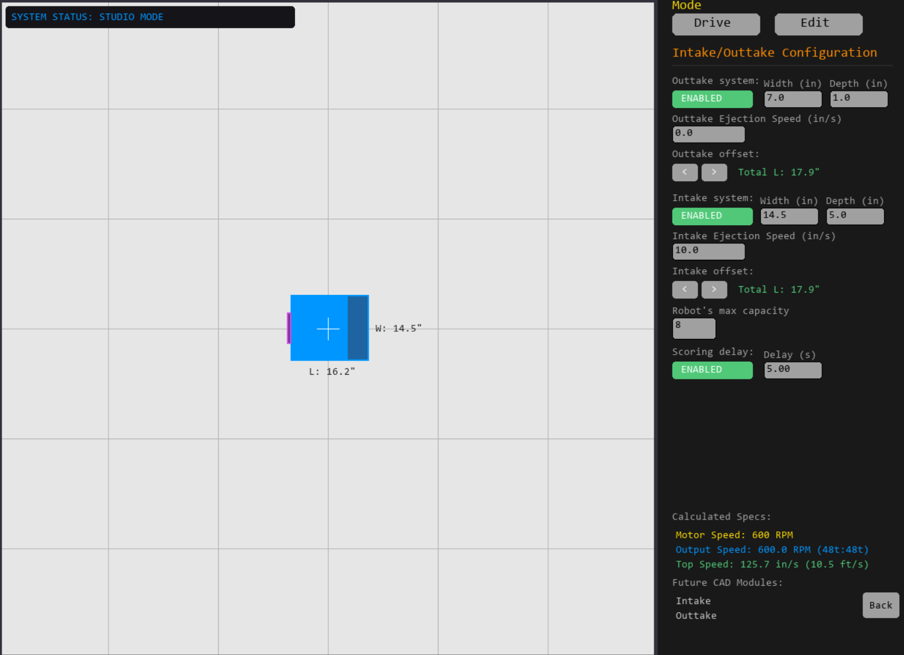 

Not just the outtake appearing in Studio mode CAD/display model; it works in Drive mode too!! 🥳

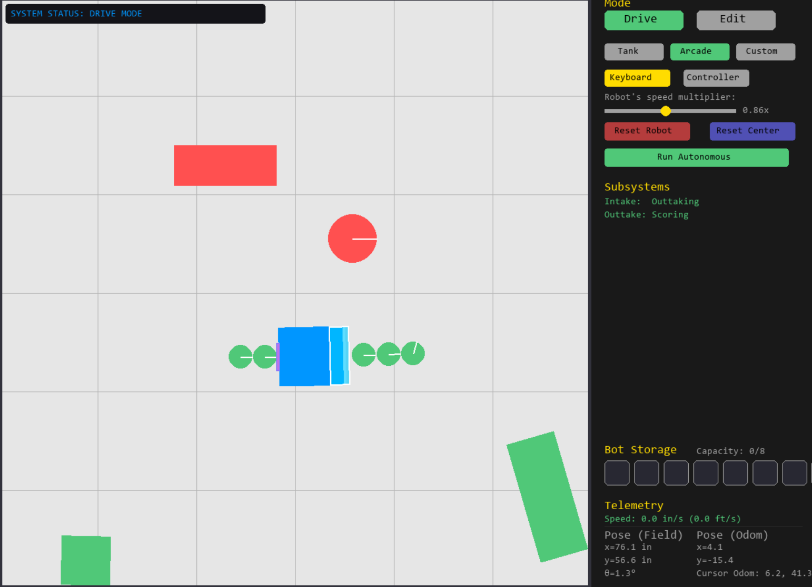 

## [Unknown date, after Aug 2nd] - Fix the simulator according to M's suggestion (I gotchu bro🙂)

One of my early testers, who is also my teammate, had questioned why I have the paused menu for Drive and Edit mode but not Studio mode. Before that, the user would have to click back on "Drive" or "Edit" at the top of the sidebar to exit Edit mode, and it would be naturally logical that the user used the pause menu to get to Edit mode, so they also use the pause menu to get out of it. So I fixed that, with some custom text saying "Return to drive mode" in Studio to make sure they know :)

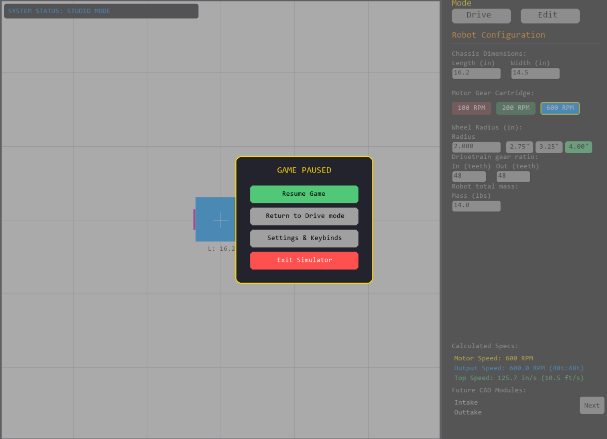 

## [August 3rd, 2026] - Gamifying the simulator through UI works

As I said before, I wanted to make this simulator feel less of a "sim" and more of a "game" where everyone can enjoy, mess around, and test their robot on a semi-realistic practice program. That is why I added what most "gamers" would call a "cooldown" for the robot's outtake. Originally, I wanted to simulate the realistic feeling of the game element needing to traverse inside the robot after being taken in order to score out of the outtake - so I added a delay timer in Studio mode sidebar 2 where the object would be outtake after a certain period of time (s), of course, while their outtake is on.

In the game (I would like to call it now, rather than simulator), the inventory display in Drive mode would now have a countdown over each object:

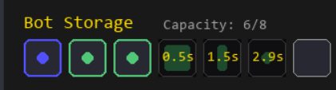 
(Also, if you noticed, the display would now show a smaller version of the Dynamic object that got taken in! Like the circles, the rectangles along with their color - so that brings out the feeling of the game too!!!🎮)

## [August 8th, 2026] - A rework in the game's UI system

As the game keeps growing, I really realize the limitations of my old way of doing UI's and its backend functions (saving, loading, clicking, typing). Hardcoding exact X and Y coordinates for every single button and text boxes was fine at the start but now I'm getting to the part (where I previously mentioned) that I would need a scrollable list of keybinds to accommodate the new functions and my goal for the most customizable game

I did some brainstorming with my AI "co-dev" to figure out how actual game devs and studios handle this scrolling challenge. Instead of a quick way of doing this (using the current way of drawing and constantly showing and hiding certain text boxes as the user scrolls), we decided to completely overhaul the structure to a "Data-Driven Component System", similar to what engines like Unity uses (better performance, simply attaching and detaching data components, and clean)

The UIElement class: Everything is an object now. We created a base class that keeps track of a local_rect (inside a menu, based on the screen_rect) and a screen_rect (base one)

Seperating UI classes to a new ui.py file: I moved all this new UI logic into its own completely independent file. Now main.py can just focus on the robot physics and game loops without being cluttered by hundreds of lines of menu math.

The ScrollView class: Where the scrolling happens. It acts as a parent container that holds a list of UI elements/children. When you scroll the mouse wheel, it automatically shifts the Y-coordinates of all its children and uses Pygame's set_clip() function to hide anything that is not inside the set range.

We built and tested the components with simple buttons first and then completely ripped out the old "Keybinds and Settings" modal draw_everything() and handle_ui_clicks(). Now adding a new button is as simple as "settings_scrollview.add_child()", no more 20+ hardcoded rectangles for textboxes and .collidepoint conditions in the main loop - Dev note: it feels like a real game now :) And expanding the game in the future with this new structure would be so much easier 🍋

## [August 10th, 2026] - A revamp in the Studio mode UI (using the new class objects from "ui.py")

Along with UIElement and UIScrollview mentioned on August 8th, I also created UIButton and UITextbox classes in "ui.py". So today I began replacing the old hardcoded UI rects with the new object-based structure, and I decided to start with Studio mode.

Because the new structure uses objects from classes, I can append them to a rendering list, which I can loop through and render in draw_everything(). Additionally, the rect declaration, the function of what to do, and rendering are all done through the class, meaning I no longer need separate global declarations, nor do I have to write out manual checks inside apply_textbox_value() for textboxes or handle_ui_click() for buttons - so not just shortening my code, but it also makes it easier to add a new button and keep the main file so much cleaner (I do still need handle_ui_click() to pass the mouse click coordinates down to the classes so they can do their function detection - like what dropdown option were picked)

Overall, after replacing the new code, I have shortened the simulator code by ~15 functioning lines (not counting for spaces/ empty line for comprehensibility)

Visual demonstration of the effectiveness and look of the old and new versions.

Before: 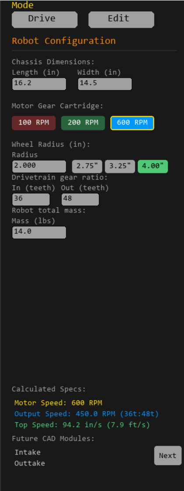 After: 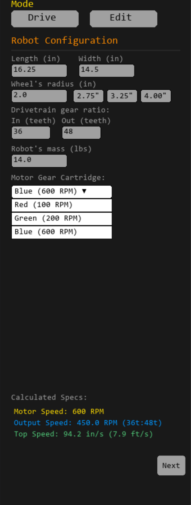

Before: 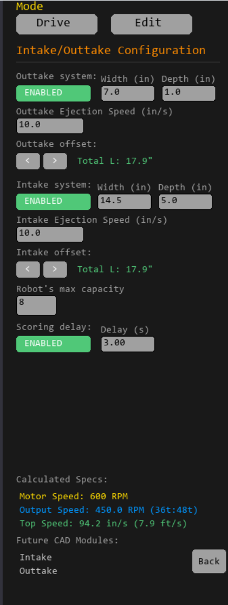 After: 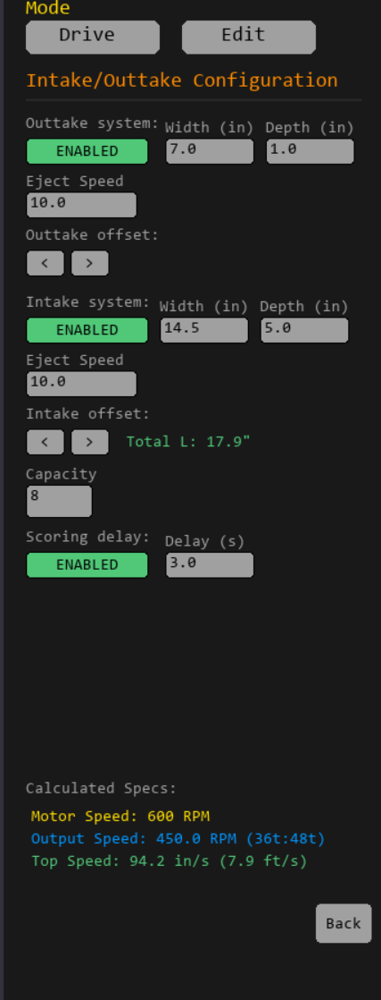

## [August 15th, 2026] - A disadvantage of the virtual simulator, and brainstorming how to fix it

One of the main reasons I built this simulator is the limitation of my school's robotics room: we only have one field to drive, practice, and test autonomous routines on. The simulator solves most of that - testing drivetrains and auton routes doesn't need the physical field. But I realized the physical field still has one advantage the sim doesn't: the opportunity to run scrimmages and practice matches against other teams. So I started thinking about how to fix that.

I came up with three ways to upgrade the sim:

_A simple collision detection system that records any hard impacts the user makes with static objects and walls, paired with a "Start" and "Finish" zone on a custom map the user has to maneuver around while carrying a game element.

_A fully dedicated bot that learns the user's driving style and movement to give improvement suggestions and predictions - essentially an "NPC" bot that drives and behaves like a real player based on collected data, able to pick up, score, and run autonomous routines, so it feels like driving against an actual opponent.

_A combination of both: a less "smart" NPC bot that simply tracks the user and deliberately drives up against them, collecting data on where they made mistakes for a final report showing when and where those mistakes happened most.

Based on the past few commits and the title of today's entry, you can probably
guess which one I picked - and it wasn't random.

- Option 1: The easiest to code, since it's just extra collision detection and logging. But it requires a whole new UI layout and mode, where every practice map has to be custom-built - and building a map complex enough to generate genuinely useful data would take a lot of time. It also doesn't solve the actual problem: simulating a real opponent. It just becomes individual driving-skill practice, which normal Drive mode already covers.
  
- Option 2: Normally the best option for realistic, useful data - but also the hardest and most time-consuming. Getting enough training data would require someone driving a huge amount, and even then, could the bot realistically simulate a real driver? People drive with keyboard, controller, tank drive, or arcade drive, and each gives a different style, tactic, and advantage. On top of that, the amount of ML I'd have to learn and the data I'd have to store made this unrealistic for the timeline.
  
- **Option 3 (Picked):** The middle ground between Options 1 and 2. Data collection happens around a specific objective the user completes while being tracked for mistakes, but it doesn't require a custom-built map that would eventually get boring and memorized - the user can just use Edit mode to build their own map, or one similar to that year's competition field. The "advanced NPC bot" gets simplified into a lead-point tracking system that follows the user's position, using driving math and turn/drive speeds similar to the user's own bot.

Started building this with my AI co-partner - I'm responsible for the design decisions above and the path to take, and they helped with implementation and complex ideas that I may not know about to make a more efficient version.

## [August 16th, 2026] - Understanding what I built

Got a working "blocking_bot.py" done with my AI co-partner yesterday. Today's work was about going through the whole file myself to make sure I actually understood it, not just that it ran.

I went line by line and wrote out explanations for the parts that weren't immediately obvious to me (like the angle-wrapping math for turning, the pairwise zip trick for calculating gaps between impacts, and how PyMunk's on_colisions and post_solve callback fit in the data recording process. I chose the easy-to-understand parts of those explanations to put into inline comments (above the code) so the file explains itself to anyone reading it later, including future me :). And of course, I still have my own Doc that have the "not so easy to understand" personal explanation that I have.

In the process, I've found an issue: since the sim runs at 60 ticks per second, a single collision could be counted as several separate "mistakes" while the player's speed was still backing up (the frames and bodies can sometimes get overlapped - calling multiple post_collision), because the speed-drop check re-evaluates every tick. So I've added a recent_impact boolean so each collision only counts once.

Note: I've gotten an error because my PyMunk in blocking_bot.py and main.py are in different versions, 6 and 7 (hahaha) that require different syntax and code structure - remember to double-check if the structure of PyMunk's post_collision, etc are up to date to ensure that your file won't error

[August 20th, 2026] - Game design research and application

===The Problem=== After adding a functional blocker toggle and difficulty selection and driving around, I realize that the difficulty setting for the blocker is not "game-like" (from my experiences playing games with difficulty settings), and the movement felt "fake" because everything is instant; it drives always in a smooth, robotic way rather than the "realistic-human opponent" I was trying to stimulate

After taking a look at game design and how they create the illusion of "difficulty" along with my personal experience, I realize that they use various subtle things that people would normally not notice individually but together create the effect of a jump in difficulty:

- Enemy's skill or mistakes: One of the most recognizable changes is the change in numbers and skills. For example, in Minecraft, Hard mode results in enemies dealing more damage, making them "harder" despite everything else being somewhat similar to easier modes. Another way to accomplish this direct feeling of "harder enemy" is them making fewer mistakes and being more tactical (like Alien: Isolation, known for its innovative enemy AI where it learns and adapts to the user's behavior) - thus leading to the fact that easier modes need to have the enemy making mistakes and being "dumb" to create the feeling of them getting smarter when theres little to no error in the behavior
  
- Resource scarcity + punishing mistakes: This includes decreasing the resources available to the user (healing, ammo, shield, etc.) and creating a more punishing game mechanic/map structure (less total health points, no more shields, able to bring less support, checkpoints are further from each other, etc.). By doing so, the user would have to be more careful and decisive on their actions because they now have limited resources, and their mistakes would be punished more  - creating the feeling of increased difficulty and making winning feel deserved
  
- Enemy's behavior and "attacks": Roguelite games (where the user goes through the same process/map to beat the game many times, with each time getting harder - my favorite type of video games) like Dead Cells would introduce new types of enemies, each with a new unique behavior and counter to have toward them that be more and more complex and difficult to manuver around or predict their "attack"

===The Application=== (Only idea and future plans stated) Now that I have looked into ways to improve the simulator based on it. 

- Improvement 1: I have mentioned the enemy making "mistakes" as one of the ways to ease/make the game feel less difficult, but also to make the blocker more "human" and natural rather than the constant rotation and velocity with immediate tracking of the user's bot with zero mistakes. I plan to modify and change turn_gain for each mode - on Easy mode, the blocker would have such a low turn_gain that it would be possible for the user to make a sharp maneuver without having the blocker keep up with the sudden change of speed; and keep increasing it from there. Further improvements would include: overturn, underturn, can't turn fast enough, get tricked when there is a sudden change in direction
  
- Improvement 2: I also mentioned the feeling of "limited resources" to drive the stakes and increase the difficulty. In the simulator, I won't have health or checkpoints to punish the user, but what I do have is space and the impact vector of the blocker and robot. I plan to implement a new stop_distance (10in, 5in, -3in) that would represent the blocker's stopping distance from the bot and be more like a "Im blocking you from afar, playing safe and defendsively" to "Im closing the gap so that I may have occational collisions" to "I will keep going toward you (negative inches) and play offensively". The impact strenght can also play a role in the "punishing mistakes" part where the harder the user collide (which I am to get from the length of the collision vector) the more it will affect the report like ("tap" or "full collision" at ____ part of the map) which then can be used as data for the team to practive/ learn where they usually have to most collisions like at specific corners or when played defendsively by the blocker and panic
  
- Improvement 3: Finally, I mentioned enemies having new attacks (have to shout out my fav game genre) to up the difficulty and make the game more engaging/force the user to adapt. I plan to combine Improvement 2 with new mechanics of the blocker: the blocker is able to represent playing style (defensive, adaptive, offensive) by keeping their distance from the bot but new improvements like defend_one (blocker move side by side from afar), defend_two (blocker move toward scoring zone rather than bot to prevent scoring), offend_one (find nearest wall from user, goes to the opposite side and try to pin the user against wall), offend_two (keep pushing the user until hit something and back away to push again - preventing the 5-second limit pinning rule), adapt_one (drive between user and scoring zone if its the nearest path, else keep pushing the user around), adapt_two (keep driving forward real close at high speed and back away - to scare and induce collisions), etc. The blocker class would rotate randomly from the playing style list, each with its own tag (defend, offend, adapt) that would be based on the blocker difficulty and numbers mimicing real teams that I have observed to ensure that the user will have "new enemies" to drive against everytime they restart - no practice is the same, maximizing adaptation and tactical thinking to deal against different teams.

## [August 22nd, 2026] - Identifying (2) flaws in the Blocker prediction/driving

While playtesting (driving around with the new Blocker's visual prediction line) I found two issues with how it really works and predicts where I'm going:

- The Blocker predicts using my “input” or “commanded” speed, not my actual physics speed. So if I ram into a wall, the Blocker keeps predicting forward (into the wall) at full speed even though I’m not actually moving anymore because I was simply holding the drive forward button, which the Blocker counts as “driving”

- The Blocker has no awareness of what’s between it and its target location. It just drives straight at the predicted point and gets stuck if something’s in the way - there’s no rerouting, no backing off; it's simply stuck in place and keeps driving forward into the obstacle

===The Fix=== I plan to fix the speed source by using my actual velocity (from PyMunk) instead of input speed for the first problem. Then I'll give the blocker obstacle awareness using raycasting (projecting a line in front of the Blocker to detect obstacles) so the Blocker stops first. Finally, for the "big and time-consuming” fix would be to increase the number of rays cast in a small spread around the Blocker’s driving direction (to account for driving backward) and find which rays are not intercepted and are "open” to drive toward - just a simple check every frame, similar to how I see game devs do (shoutout to Dani :) ) and robots, using sensor arrays to avoid obstacles

No implementation yet; this is just a “problem identification” and the direction I’m taking, but expect the next journal to include a working version!!

## [August 24th, 2026] - Status update and identifying new problems for Blocker's "AI pathfinding"

I implemented multiple rays (currently 7), which need to be odd to accommodate my new weighted steering system. 

===How it works==== Every tick, the Blocker would recalculate its angular velocity (degrees to turn) by adding every 0s (aka clear) ray’s angle to a new desired angle variable - clear rays on the left would subtract, and on the right of the Blocker would add - except the middle front rays (reason for odd number of rays). This ensures that if there’s nothing in front, the variable’s value is 0, but if one side has more 0 rays, it’s deemed a “safe” route to turn to. But for a situation where the obstacle is right in front of the Blocker, it would need to pick a side to steer to; hard-coding a side is possible, but I decided on a “weighted” or “bias” system where rays toward the direction of the user’s bot would be weighted more (multiplied the added angle by 1.5) so Blocker would lean toward the user. Additionally, I have implemented a new braking system: the more front rays (the middle one and the two next to it) detect an obstacle, the more braking (1 ray -> 20% down; 2 rays -> 45% down; 3 rays -> 70% down)

===The Problem==== However, this new system I created results in some problems/flaws when I test drive. It would work most of the time but there are certain situations where the Blocker would begin breaking down

 - The weighted system works well assuming the user is either on the left or right of the Blocker’s driving direction, but when the user is directly in front of the Blocker, and there’s an obstacle between them, no “side” would be “biased”; thus, they keep canceling each other and result in no change in direction/ steering.
 - The blocker has no memory of the surroundings; thus, the moment it gets stuck in the wall, it can’t back up and retrace where it was to try another direction. This is not realistic, as in a VEX V5 match, the driver has a whole map view (meaning they know what is behind the so-called “obstacle” that the simulator’s Blocker is seeing) and can pick the best route without needing to get stuck and recalculate their new direction like the Blocker

===The Proposed Solution==== I currently have in mind of what to do to fix the problems mentioned 

- For the first problem: Instead of purely based on the “biased” rays to pick a direction to turn, I plan to add another variable (or list) that tracks the user’s previous routes/locations, and the Blocker would take that side as another “biased” side to turn to. However, it would be difficult to determine the correct locations the bot was in to use - I'm currently looking into how to fix it
- For the second problem: I plan to use a grid system that would progressively grow branches from the Blocker until it reaches the user, similar to 
a version of Dijkstra’s algorithm used in Maps and GPS to pick the best route to go from one point to another. More in the next documentation

## [August 26th, 2026] - Update on Blocker (blocking_bot.py) and images of its tracking system

I implemented most of the ray drawings (visible rays on the field for debugging; red when an obstacle is detected, yellow otherwise) and the math (slowing down; each ray holds a value for steering; biased turning), and got the Blocker LiDAR system functioning.

Functions of the Blocker: A PyMunk physics object that can interact with the field elements and the user; LiDAR rays for navigation; log collisions with the user to give a summary of the match at the end (when and where the user makes the most mistakes)

However, there are still some bugs to fix, like tight turns where Blocker can’t slow down (translating linear velocity into angular velocity) while the user can, not knowing which biased direction to turn to if the user is in front of them but on the other side of a wall; Blocker always drives forward, leading to often getting stuck in a corner and can’t drive backward, not being able to drive strategically and follow behind the user blindly, etc. 

## [August 27th, 2026] - Giving the Blocker a way to actually see obstacles

Up until now, the Blocker just drove straight at the player with no idea what was in front of it - if a wall happened to be in the way, it would just plow right into it. Real robots don’t have this problem because they have sensors, so I figured the Blocker needed something similar.

I built a simple version of what’s basically LiDAR: instead of one line looking forward, I cast several rays out in a fan shape from the front of the Blocker, each one a few degrees apart. Every ray checks if it hits something within a set distance. If it does, I mark that ray as a 1 and draw it red. If the path is clear, it’s a 0, and I draw it yellow.

The reason I used multiple rays instead of just one straight line: one ray can only tell you "something is directly ahead," not which way is actually open. With a spread of rays, the Blocker can start to tell the difference between "wall on my left" and "wall on my right," which is the whole point: reacting instead of crashing.

This is just the sensing part for now - the rays exist, and they correctly show red or yellow, but the Blocker doesn’t actually change how it drives based on what it sees yet. That’s the next step.

## [August 28th, 2026] - Found a blind spot right in front of the Blocker’s own rays

===Problem==== While testing yesterday’s ray system, I ran into a bug: the Blocker sometimes drove straight into something even though the rays were supposedly watching that direction the whole time.

===Reason=== Every ray starts slightly away from the Blocker’s body, so it doesn’t immediately detect the Blocker itself as an obstacle. The distance I used to push the ray’s starting point out was based on the CORNER of the Blocker’s box shape, which makes sense for rays pointed diagonally, since they really do need to clear the corner. But for the ray pointed straight ahead, that same corner distance is way more than it needs, since the front of the robot isn’t a corner; it’s a flat edge much closer to the center.

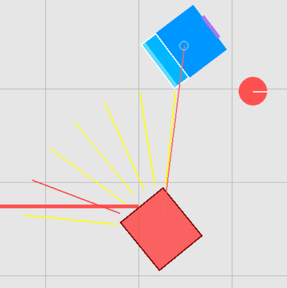

That gap between where the front ray starts and where the real front bumper is becomes a blind spot. Anything thin enough to fit in that gap - sitting directly in front of the Blocker - would never get picked up, because the ray physically starts on the other side of it.

Haven’t fixed this yet, just tracked down exactly where the problem is coming from. The fix will probably mean figuring out the starting distance separately for each ray’s angle, instead of using one fixed number for all of them.

## [August 30th, 2026] - Fixed the front blind spot on the Blocker’s rays

Went back to the gap I found on the 28th - the front-facing ray was starting way further out than it needed to, leaving a blind spot where a thin obstacle right in front of the Blocker would never get seen.

The old code used one fixed distance for every ray, based on how far it is from the center of the Blocker to a CORNER of its box shape. That distance makes sense for the rays pointed diagonally, since they need that extra room to clear the corner. But the front-facing ray isn’t pointed at a corner - it’s pointed straight at the flat front edge, which is a lot closer to the center than the corner is. For my Blocker’s actual size, the corner distance was about 10.9 inches, but the real front edge is only about 8.1 inches out. That difference, close to 3 inches, was the blind spot - big enough for plenty of real obstacles to hide in.

The fix was to stop treating every ray the same. Now each ray figures out its own starting distance based on its own angle - the straight-ahead ray uses the short distance to the front edge; the angled rays still use the longer distance out to the corner. Same idea, just calculated separately instead of one number for all of them.

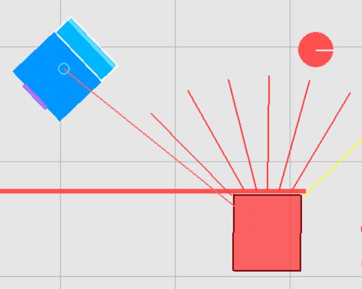

Simple example to explain why this matters: imagine standing with your back against a wall, arms stretched out to your sides. If you swept your arms in front of you to feel for something, you wouldn’t start feeling around from three feet in front of your chest - you’d start right at your fingertips. That’s basically what was wrong before, and what’s fixed now.

## [September 6th, 2026] - Giving the Blocker a memory of where the player’s been

I ran into a real limit with the ray system a while back: it only tells the Blocker what’s happening right in front of it, right now. If the player was hiding behind a wall the Blocker couldn’t see around, the rays were useless - the Blocker had no way to know there even WAS a way around, because it can’t see past what’s directly in its own view.

But there’s information sitting right there that I wasn’t using at all: the player has to actually drive somewhere to get anywhere. If I just keep a running record of the player’s last several seconds of positions, that trail IS a proven path - the player already got from point A to point B somehow, so a straight line to one of those old points is basically a guaranteed way around whatever’s currently blocking the direct view.

So now the Robot keeps a short list of its own past positions, saved every fraction of a second, dropping anything older than about 12 seconds so the list doesn’t just grow forever. I also added a way to see it on screen: small dots along the trail, and a green line showing which specific point the Blocker is currently aiming for.

This doesn’t change how the Blocker drives yet - right now it’s just data being collected and a way to see it. The next step is having the Blocker actually use one of these points as a target when it can’t see the player directly.

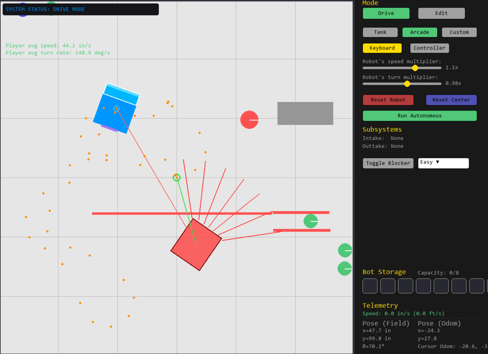

## [September 8th, 2026] - Breadcrumb targeting kept changing its mind

I ran into two separate problems while testing the breadcrumb system, and both came down to the same root issue: the Blocker was switching its decision too easily, instead of sticking with a choice long enough for it to work.

The first one was with picking which breadcrumb to go to. Every frame, the Blocker recalculated “which breadcrumb is closest to me right now” from scratch, with no memory of what it picked the frame before. If two breadcrumbs happened to be close together, even a tiny wobble in the Blocker’s position could flip which one counted as “closest,” and the target would constantly swap back and forth. It’s a bit like standing between two stores that are almost exactly the same distance away and constantly turning around to walk toward the other one because you took one extra step closer to it. Nobody actually gets anywhere like that. The fix was to make the Blocker commit to one breadcrumb and keep going toward it, only picking a new one once the current one is actually reached, gone, or blocked - not just because something else became a hair closer.

The second problem was with how the Blocker decides it’s “stuck” in the first place. That decision used a single number: if the Blocker made enough progress toward the player, it decided it wasn’t stuck anymore. But that same one number was used both for deciding it’s stuck and for deciding it’s NOT stuck anymore, which caused a weird loop: the Blocker would make just enough progress to be considered “not stuck,” go back to normal driving, immediately run into the same wall it hadn’t actually gotten around yet, and flip right back to “stuck” again a second later. So I split it into two different numbers - a low bar to decide it’s stuck, and a noticeably higher bar it has to clear before deciding it’s not stuck anymore. Now a small amount of progress doesn’t count as “solved,” which stops the back-and-forth.

Both of these are really the same lesson: don’t let a decision flip back and forth on a technicality. Make it earn the right to change its mind.

## [September 9th, 2026] - Three small breadcrumb bugs found while retesting

After fixing the flip-flopping from the day before, I went back and properly tested the breadcrumb system, and found three more things wrong with it. None of these were huge on their own, but together they were making the whole system feel unreliable.

The first one: the line I use to check “can the Blocker actually see this breadcrumb” was starting from the exact center of the Blocker’s own body. That's the same kind of mistake I found with the rays back on the 27th - the check would sometimes count the Blocker’s own body as being in the way of itself, which doesn’t make any sense. I fixed it by starting that line from the edge of the Blocker instead of the center, the same fix I’d already used for the rays.

The second one: breadcrumbs were getting recorded purely based on time, one every fraction of a second, no matter what. That meant if the player sat still or wiggled back and forth in one small spot, the trail would fill up with a bunch of points that were basically on top of each other. That’s not useful information; it’s just clutter. So now a new point is recorded only if the player has actually moved a real distance since the last one, not just whenever the timer goes off.

The third one: once the Blocker actually reached a breadcrumb, that point never went away - it just got skipped over while the Blocker was standing right next to it. But if the trail later looped back near that same spot, the old point was still there, ready to be picked as a target again, even though it wasn’t useful anymore. Now, once the Blocker actually reaches a breadcrumb, that point gets removed for good.

Small fixes individually, but this is the first time the code in blocking_bot.py has ever changed something that belongs to the player’s own data instead of just reading it - worth keeping an eye on if that ever needs to be shared with anything else down the road.

## [September 11th, 2026] - The wall bug (+ solution), and the Blocker turning into a ghost object

Two completely unrelated bugs today, both annoying in their own way.

===The Wall Bug=== I noticed the Blocker would stand still whenever it ran into a wide, flat wall with only a little open space on the far left and far right. All the middle rays were blocked; only the two outer edge rays were clear.

The Blocker normally decides which way to steer by adding the direction of every clear ray to get one average direction. That works fine most of the time, but it falls apart here: both clear edge rays point mostly forward, just slightly to each side. When you average "slightly left, mostly forward” with “slightly right, mostly forward,” the sideways parts basically cancel out, and you’re left with... mostly forward. Straight into the wall. The math wasn’t wrong; it was just answering a question that didn’t actually help here - it’s like trying to average “turn left” and “turn right” and expecting a useful answer instead of getting basically nothing.

===The Fix=== When the middle rays are ALL blocked, stop averaging and just pick whichever single edge ray has the most room, then aim directly at that one. No blending, just commit to the actual opening.

===The Ghost Object Bug=== Separately, I found that if the Blocker was turned on and I switched over to Edit mode, it would visually disappear but somehow still be sitting there in the game’s physics. It’s definitely not supposed to happen.

I traced it to a function that clears out and rebuilds all the custom field obstacles whenever you switch modes. That function was told to leave the player’s robot alone while it cleared things out, but nobody told it to leave the Blocker alone too. So every time you switched modes, the Blocker’s own body was getting swept away along with everything else - except the game still thought the Blocker was properly placed and working, since nothing ever told IT that it had just been removed.

Fixed it by protecting the Blocker’s body and shape the same way the player’s robot was already protected, so it doesn’t get wiped out every time you change modes.

## [September 12th, 2026] - Letting myself actually move the Blocker around

Up until now, the Blocker always spawned in the same fixed spot every single time. That’s fine for quick testing, but it meant I couldn’t easily set up different starting positions to see how the Blocker handles them - like where the real opposing robot would actually start on the field this year. So I added the ability to click and drag the Blocker around while in Edit mode (the exact same way I drag my own robot around).

While testing that, I ran into a bug: the rays and the line showing where the Blocker is aiming froze the second I started dragging it. They stayed exactly where they were before I switched into Edit mode, floating in empty space and totally disconnected from wherever I’d actually dragged the Blocker to.

===The Reason=== All of that debug drawing only gets recalculated inside the same function that handles the Blocker’s actual driving logic, and that function only runs while I’m in Drive mode. So the second I switch to Edit mode, that function stops running completely - which means the rays and the aim line just keep showing whatever they were last set to, frozen, like a photo instead of a live view. Made sense once I found it, but it looked really broken before I knew why 😢.

For now I just made the rays stop drawing entirely while in Edit mode, since a frozen, wrong picture is worse than no picture at all. The Blocker can be dragged around cleanly now, but the rays only come back to life once I switch back to Drive mode and the Blocker starts actually "thinking" again.

## [September 20th, 2026] - Giving the Blocker an actual map of the field

===The Problem=== Blocker kept running into the walls with the ray system: it can only tell what’s directly in front of it at that time. It’s good for reacting to something that just showed up, but has zero sense of the field as a whole. The corner-wedging bug and the wall-hugging bugs I had been fixing were really all the same root issue - the Blocker has no actual plan, just a reflex.

===Brainstorming & Solutions=== I looked into two different ways to give the Blocker a “whole map” awareness:

_1. Visibility Graph: Connect the corners of every obstacle together with straight lines a robot could legally travel along, then search through that graph to find a route. This is the classic way of many pathfinding algorithms that I have looked into.
_2. Grid-Based Occupancy Map + A* (Chosen Strategy): Rasterize the whole field into a grid of small cells, mark each one open or blocked based on what’s currently there, and run A* search over that grid to find a path.

===Why Option 2 Wins=== The deciding factor came down to one thing specific to this sim: every obstacle on the field is fully user-editable in Edit mode. A visibility graph is built directly FROM the obstacle geometry, so the second something gets dragged, resized, or added, the whole graph is stale and has to be rebuilt by hand - and I’d have to write separate logic just for “what happens if two obstacles start overlapping”. A grid bypasses all of that: it just gets rasterized fresh off whatever shapes currently exist, with no extra steps. For a sandbox where the field itself is what people are supposed to customize, that makes the grid the much better choice.

===Status=== Built and tested the occupancy grid rasterizer and the A* search over it independently. Haven’t wired either one into the Blocker’s actual steering yet; that’s the next step. To be clear, this isn’t replacing the ray system - rays are still the right tool for fast, close-range reacting (something just appeared right in front of the Blocker, no time to replan), while A* is for the bigger, whole-field-level decision like which path is better.

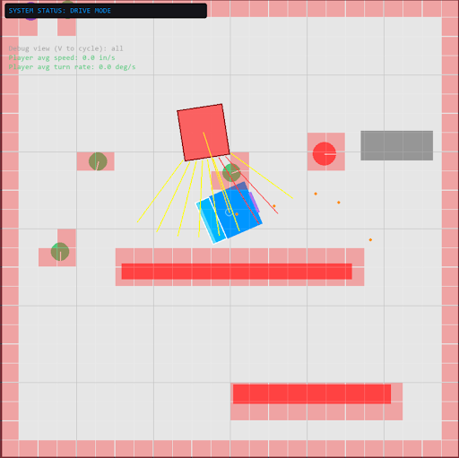

## [September 22nd, 2026] - Wiring the grid into the Blocker’s actual driving

Picking up from the 20th - the occupancy grid and A* search worked fine on their own, but the Blocker wasn’t actually driving off either of them yet. Today was about actually plugging that in.

===How it works=== Every tick, the field gets rasterized into a grid of small cells (6 inches each, so a 144x144in field turns into a 24x24 grid), and each cell gets marked blocked or open based on whatever’s sitting on top of it right now - walls, static obstacles, dynamic ones, all of it. A* then searches across that grid from whatever cell the Blocker’s currently in to whatever cell the target is in.

The part I had to think through was HOW the Blocker actually uses that path once A* finds one. Just aiming straight at the final goal cell would undo the whole point of using a grid in the first place - that’s basically back to square one, driving in a straight line and hoping nothing’s in the way. So instead, the Blocker looks a few cells AHEAD along the found path, not at the very end, and steers toward that closer point the same way it already steers toward any other target. As the Blocker gets closer, that lookahead point keeps sliding forward along the path, so it’s less “drive to this one fixed spot” and more “keep aiming a little ways ahead of yourself along the route.”

I also kept the ray system completely in charge of anything close-range - the grid path only takes over once the ray fan comes back fully clear, meaning nothing’s close enough to react to right now. If something IS nearby, rays still win. A* is for “which general direction should I even be heading,” not for dodging something that just appeared two feet away.

===Status=== Rays + grid are both driving the Blocker now, rays first, grid as the fallback/backup layer. Ran into a performance hit almost immediately from rebuilding the whole grid every single frame, 60 times a second, so that’s throttled down to rebuilding only every so often instead of constantly - more on that if it ends up causing its own problems.

## [October 12th, 2026] - Quality of life features for the User in Edit mode, and the new Load Field system

===Quality of Life Features===
These are some of the things I have added over the last few days to make Edit mode feel nicer for the User:
- Undo (Ctrl+Z) and redo (Ctrl+Y) for anything done to the field shapes
- Drag a box to multi-select, then move, rotate (R), or copy (Ctrl+D) the whole group at once
- Select all (Ctrl+A), with a warning pop-up if the User tries to delete everything on the field
- A small red message that slides in when an action can’t be done, like “No more undo” so the User knows that the button is working or can’t
- A see-through box for the status bar and the selection hint, which fades even more when the mouse goes over it so the User can still see and grab what is behind it

Two design choices I want to remember here. For undo, I didn’t save a copy every time a shape changes (dragging, resizing, deleting, typing in the sidebar, and so on). The loop compares the shapes to the last saved copy only when nothing is being dragged, so one whole drag counts as one step instead of hundreds, and any new editing method gets undo for free. And the delete everything pop-up intentionally doesn’t react to Enter, since a stray Enter shouldn’t wipe a field.

===The Load Field System===
Moving back to today’s main focus: the Load Field system. When I started building the simulator, it was meant for our whole robotics team to practice driving and test our robot when we have a limited field. That led to additions like the Blocker, which lets us practice against another "person" at different difficulties. But that does not cover the “practice for this year’s field” part.

So I thought of a Load Field system that works like the saved worlds in a game like Minecraft. The User can drive in an empty field, load a pre-made field that targets a specific driving skill, or build their own field, mess around with it, then save it, load it back later, and have it return to normal. No more moving every object back by hand, and no more fear of losing a field they spent time on when they just wanted to try something else. It is a sandbox after all.

===What I Built Today===
- A new **Load Field** button in the Pause menu that opens a list of fields
- Two pre-made practice fields to start with: "Practice drive - easy" (an open field with 3 blocks and 4 pieces to push around) and "Practice drive - medium" (center walls with gaps, corner blocks, and 6 pieces)
- Gaps between obstacles are kept at 24 inches or more, so a normal-sized bot can always get through. These are for practice, not for getting stuck
- Loading a field replaces the current one, so it asks first. I turned the delete everything pop-up into one shared confirm box, so anything else that needs an "are you sure?" can reuse it

===What is Next===
- An “Add your own field” button at the end of the list, with a plus like in other games. When the User adds one, it shows up in the list, and the plus button moves down below it
- Saving a field under a name, so it can be loaded back later
- The official 26-27 field, once I have the layout
- More practice fields that each target one skill, like tight turns or pushing pieces
- A short tutorial that lists everything the User can do in each mode (Ctrl+A, Ctrl+Z, resizing, changing properties, and so on)

Status: undo only brings back the shapes for now, not the robot start, the Blocker start, or the Defend flag after loading a field. I will look at that when I add saving.
## [October 16th, 2026] - Update on the Load Field system (images)

Update on the Load Field system: I have added “Save current field” as a way for the user to save their fields and load them later, along with the option to edit a custom field (that the user made, not the pre-built one that comes with the simulator’s code file) to change its name. Though I haven't added this year Override field yet

I have also added 2 new more pre-built fields that help the user practice their driving:

## [October 17th, 2026] - Letting users send each other fields

I wanted to add a way to share a custom field with a friend as a short text string (for example: the user builds a field, presses Share, and gets something like VEXF1:eNqtkk.... and then the friend can paste it into Import and the field shows up in their list. I wanted this because a field is only useful for practice if the people you practice with can have it too, and nobody is going to send each other a save file (that would be too much work rather than this simple copy-paste method)

Here, I’ll explain how this works because “code” sounds like encryption, but it isn’t. There are no keys and no math equations. It’s just 3 steps to generate the “code”:

1. Turn the field into a line of data (shape positions, sizes, colors, where the robot and the Blocker start).
2. Squeeze it with zlib compression. It’s the same idea as a zip file, and it takes the 13-piece practice field from about 740 characters down to about 180.
3. Turn the squeezed bytes into plain letters and numbers (base64), so it’s okay being pasted into a text message. The finished code is about 240 characters.

Anyone can undo those steps, and that’s on purpose. I considered a more encrypted, complex approach but decided against it. A field layout isn’t secret; it’s meant to be shared so everyone can use it, so there’s nothing to protect. A key would also defeat the point, since the receiver would need it too, and then I’m back to the problem of how to share it. It would look secure but be useless. As long as the custom field is easy to share and doesn’t risk losing anything, it’s fine for me. 

The part that needed real engineering was safety. Anyone can generate a code, so the sim can’t trust it. It only reads the code as plain data, never runs it, and checks every code before using it. A shape has to fit on the 144-inch field, and its size and mass have to be sensible, with a cap of 150 shapes. I also cap how big a code can unpack to, because a tiny code can unpack into something huge and freeze the sim, like a zip bomb. I tested various kinds of bad code, and each one gets refused with a short reason like “That code is damaged” (“...out of range”, “Shape type is broken”, “Field has no name”, “Code is too big”, etc.).

The VEXF1 at the front is the format version. If I add new shape properties later, new codes can say VEXF2 and old codes keep loading. A code from a newer sim gets a clear “different version” message instead of crashing the sim.

One more decision was the fallback. Copy and paste doesn’t work on every computer, so Share can also save the code to a text file, and Import can read it. However, on my personal laptop (Windows), Ctrl+C and Ctrl+V work perfectly.

Heres the current look of the sharing and importing boxes:

## [October 19th, 2026] - Splitting Load Field into Practice and Custom tabs

===The Problem=== The Load Field screen kept growing (up to 4 built-in practice maps now); the user can save their own fields on top of that, and the official Override field is still planned. Those two kinds of maps don’t even need the same buttons: a built-in map should never be renamed or deleted, while a saved one should be shareable, renamable, and deletable. Putting them in one list meant either showing buttons that don’t work on half the rows, or hiding them and making the list confusing.

===What I Built/Added===
- Two tabs at the top of Load Field: Practice (4) for the maps that come with the sim, and Custom (1/8) for the fields the user saved. The number on the Custom tab shows how full it is, so the user finds out about the limit before hitting it
- The screen opens on Practice (pre-built ones), since that is what most people would want
- Only Custom rows get the Share, Edit, and X buttons. Practice rows are just the map name and a one-line description (e.g., “Weave 4 posts, 3 pieces to grab”, etc.)
- “+ Save current” works from either tab. If the user presses it while on Practice, it jumps to the Custom tab so they can see the field they just saved instead of wondering where it went
- Switching tabs puts the list back at the top, and the mouse wheel scrolls a long list
- The cap stays at 8 saved fields for now, and a message slides in (“Field list is full (8 saved)”) when the user hits it

===A Small Thing Along the Way=== While I was in there, I noticed the buttons gave no sign the mouse was over them, which makes a menu feel dead and un-interactive. So every button now gets a little lighter when the mouse is over it. I put that inside the shared button class in ui.py, so every button in the game got it, not just the Load Field ones. A button with its own hover color still uses that one (just a lower hex value). 

===Why Tabs=== The other option was one long list with “Built-in” and “Saved” headings. But every new practice map (and the Override field) would push the user’s own fields further down the page, and they would have to scroll past maps they don’t own to find theirs. Tabs keep each list short and the user’s own fields in one predictable place. The trade-off is one extra click to see the other list, and I think that’s fine.

===What is Next===
- The official Override field will go in the Practice tab once I have the layout
- More practice maps that each train one skill
- Still planning the first-time tutorial that shows what each mode can do

## [October 22nd, 2026] - A match clock, and a heading for the Blocker

===The Problem=== Up to now, Drive mode just never ended. That is great for messing around, but it doesn’t feel like a match, and the user is practicing for a real match. There is no pressure, no autonomous period, and no “the buzzer went off, hands off the controller” moment. I also noticed the Blocker always started pointing at the same angle, while in a real match each robot starts facing a specific direction.

===What I Built===
- A match clock in the top right of the field: AUTO (cyan) for 15 seconds, then DRIVER (green) for 105 seconds, so 2:00 total. The last 10 seconds switch to ENDGAME (orange), and the clock ends on MATCH OVER (red). All the lengths are constants at the top of the clock code, so a future game with different timing is a one-line change
- One button in the Drive sidebar that changes with the situation: Start Match, then Stop Match while it runs, then Restart Match once it is over
- Pausing the game freezes the clock, because it only counts while the sim is actually running
- When the match is over, the driver controls stop working. I tested this by holding the forward key after the buzzer: the robot didn’t move, and driving worked again as soon as a new match started
- Loading a different field resets the clock, so a leftover “MATCH OVER” never follows the user onto a new map
- A start heading for the Blocker, set in Edit mode with a number box in the Edit sidebar’s robot settings. It is saved with the field file, with saved fields, and inside the share code

===A Decision About Share Codes=== The Blocker’s heading had to travel inside the share code from October 17, or a friend would import the field and the Blocker would face the wrong way. I made it an optional item in the code instead of changing the version to VEXF2. Code without it still loads fine (the Blocker just gets the default heading), so every shared code keeps working. A new version only makes sense when old codes would break, and these don’t.

===What is Not Done===
- The Blocker is not tied to the clock yet. It keeps driving after MATCH OVER, which looks odd when the user’s robot has stopped
- Starting a match doesn’t put the field back to how it was loaded. If the user scored pieces in the last match, they still show as scored.

[October 24th, 2026] - Brainstorming for the match loads and building it

===The Problem=== In a real match, a robot doesn’t only pick up what is already on the field; a teammate also feeds new pieces in at a loading spot. Right now, the sim has no way to do that. So there can’t be the “drive to the loader, grab one, drive back and score” loop that some teams want.

===What I Built===
- A new Loader option in the Add Shape dropdown, next to Rectangle, Circle, and Goal. It is drawn as a gray box with a double border and a round badge showing how many pieces it has left
- A Supply box in the Edit sidebar, so the user decides how many pieces each loader holds (6 by default)
- In Drive mode, the user parks the robot within 36 inches of a loader and presses G (rebindable on the keybinds page). One piece drops on the loader, in the loader’s color, and the supply badge counts down by one. Then the user just intakes it like any other piece
- Pressing G from the wrong spot gives a message instead of failing silently: “Park the robot next to a loader first”, “This field has no loader", or “That loader is empty”
- Start Match refills every loader, so each match starts with a full supply
- 

===Choices I Made===
- Loaders have no physics body. Like the goals, a loader is a zone, so the robot can drive right over it. The piece it drops is the only thing with a body, and I only add a body for that one new piece, so nothing already rolling around on the field gets bumped
- One piece at a time. If the first piece is still sitting on the loader, G says, “Take the piece out of the loader first”. Two pieces dropped on the same spot would get shoved apart hard by the physics, which would look like a bug
The supply is stored in a number that already existed. A loader’s piece count lives in the same “mass” slot that other shapes use for weight, so loaders save, load, and travel inside share codes without changing the file format or the VEXF1 version. The trade-off is that the name “mass” is a bit misleading for a loader, so I left a comment explaining it
- The user presses a key instead of it happening automatically. I wanted the driver to control the timing, because in a real match you have to wait at the loader and then leave, and that waiting is part of the practice

===What is Not Done===

The human player is instant. A real one takes a moment and isn’t always accurate, so a short delay could come later
A loader gives pieces of only one color. It can’t mix colors yet

## [Game dev having fun] - This end part would be where I show the "fun" and "interesting" bugs I came across while working on this project (that I ABSOLUTELY love!!!), so have some fun while going through it from now on

Disclaimer: I took these images on various dates, so I can’t give you the exact date, sorry!

The robot has gone crazy!!

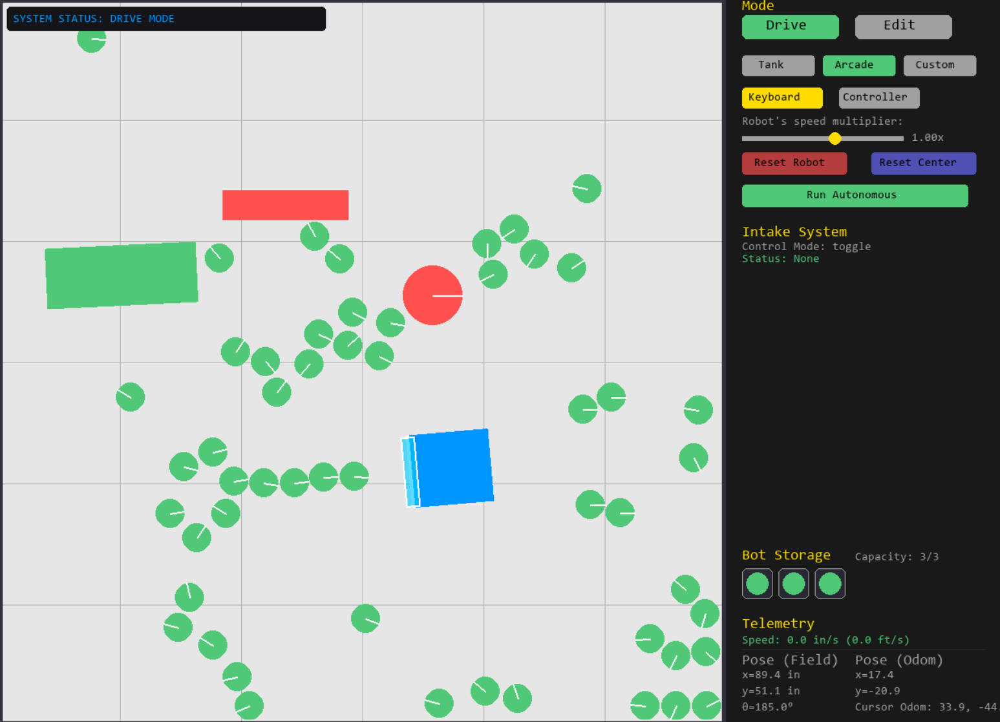

I think it detected something

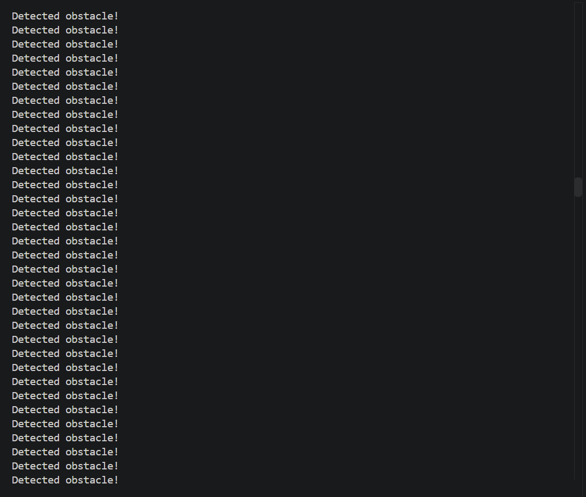

