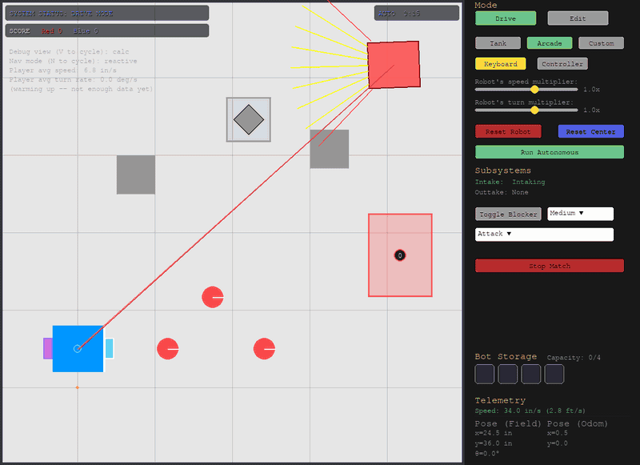
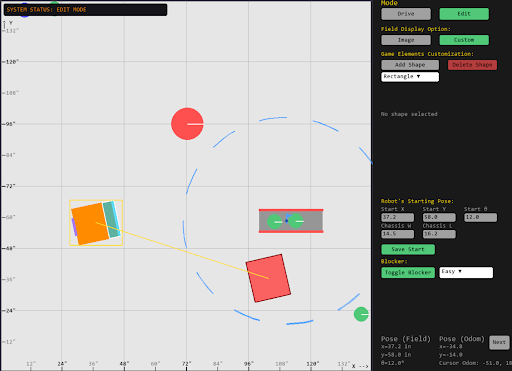

# vex-pygame-sandbox

A driving simulator for VEX V5 robots, written in Python (Pygame + Pymunk). Drive your robot, build your own field, change your robot’s size and gearing, and practice against a computer-controlled opponent that chases and blocks you.

I built it because our robotics room has one practice field. This lets a whole team practice driving, test drivetrain ideas, and run scrimmages without waiting for it.



A 12-second clip from the sim itself. The driving is scripted (a small program presses the same keys a person would), so it shows what the sim can do, not a human run.


## Try it in 2 minutes

You need Python 3 installed.

```
git clone https://github.com/P-hong-NG/vex-pygame-sandbox.git
cd vex-pygame-sandbox
pip install -r requirements.txt
python main.py
```

The sim opens in Drive mode. Press **W A S D** to drive, **E** to intake, **Q** to score, **Esc** for the pause menu. You can change every key in Settings, and you can also use a controller.

Built and tested with pygame 2.6.1 and pymunk 7.3.1. Pymunk 6 and 7 use different code, so please use version 7.

## What it does

**Drive mode**
- Drive with arcade, tank, or custom controls on keyboard or controller
- Pick up, carry, and score pieces with an intake and outtake you can configure
- Turn on the **Blocker**, an opponent robot with Easy, Medium, and Hard settings and three play styles (attack, defend, mix)
- Start a 2:00 match (15 seconds of auto, then 105 of driver) with a score bar

**Edit mode**
- Build a field from walls, movable blocks, pass-through objects, goals, loaders, and toggles
- Undo and redo, drag-select, rotate, and duplicate
- Save fields, load built-in practice maps, and **share a field as a short code** a friend can paste in

**Studio mode**
- Change your robot’s size, wheels, gear ratio, mass, and motor cartridge, and the sim recalculates how fast it can go

**VEX V5 Override (2026-27) support**
- Goals that stack pieces and score by color, with a choice of front, back, or both-sided scoring
- Loaders that a human player feeds (press **G** next to one), toggles that turn to whoever touched them last, and descoring with the intake
- Scoring that includes yellow pieces and robots in the midfield

 

## How the Blocker works

The Blocker was the hardest part, and I learned most of what I did from fixing it. The full story, including the mistakes, is in [DEV_JOURNAL.md](DEV_JOURNAL.md). The short version:

- **It sees with a fan of rays** (like LiDAR) and steers toward the open ones. This works for nearby walls, but it can’t see around corners.
- **It remembers where the player has been.** The player’s last ~12 seconds of positions are a proven path, so when a wall blocks the view, the Blocker heads to one of those points. It commits to one point instead of switching every frame, and it needs more progress to say “I’m not stuck anymore” than it needs to say “I’m stuck”, so it doesn’t flip back and forth.
- **It plans with a grid and A\*.** The field is turned into 6-inch cells every few frames, and A\* finds a route. I picked a grid over a visibility graph because every object on the field can be moved in Edit mode, and a grid just rebuilds itself from whatever is there.
- **Difficulty is more than speed.** Easy turns slowly and stops 10 inches away. Hard predicts further ahead and drives right into the player. Each time, its speed is also randomly set within 10% of the player’s own average speed, so it feels like a person and not a script.

## Share codes

Press Share on a saved field and you get something like `VEXF1:eNqtkk...`. It is the field data, compressed and turned into plain text, so you can paste it into a message. It is not encrypted, because a field layout isn’t secret. The sim treats every code as untrusted: it never runs it, and it checks every shape, size, and count before using it, so it refuses bad or oversized code with a short reason instead of freezing the sim.

## Project files

- `main.py`: the sim itself (physics, the three modes, scoring, saving and loading)
- `blocking_bot.py`: the Blocker opponent
- `ui.py`: buttons, text boxes, dropdowns, and the scrolling list
- `DEV_JOURNAL.md`: the design decisions, problems, and fixes, in order
- `TUNING_GUIDE.md`: how to adjust the robot and the Blocker

## Known limits

- The official Override field layout is not in the sim yet. It needs exact measurements. The midfield zone size is my estimate.
- Pushing power is not matched to real robots yet. It needs real-world measurements.
- The Blocker stops when the match ends, but it is not started by the match clock. If you turn it on, it drives right away, even before you press start on a match.

## How it was made

I designed the features, made the decisions, and tested it by driving it. I wrote the code with an AI assistant, and the journal notes where it helped. I also reviewed the Blocker’s code line by line so I could explain every part.
